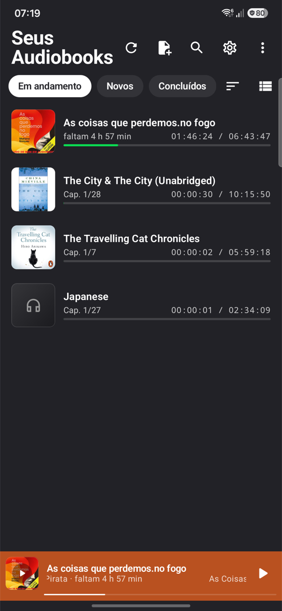
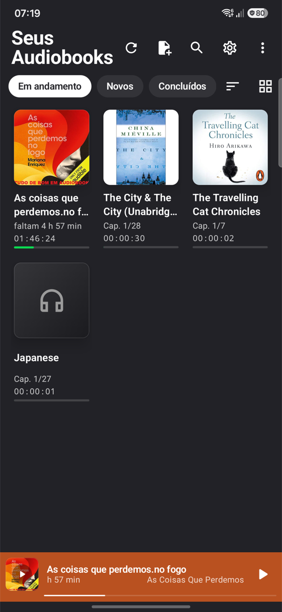
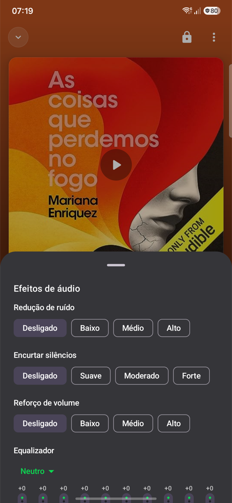
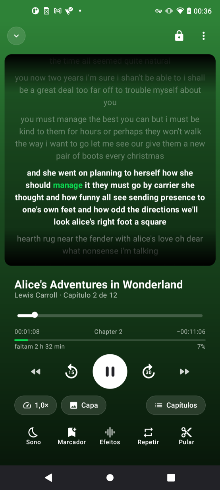

# Abbay Audiobook Player

Abbay is an Android audiobook player app built with Jetpack Compose and ExoPlayer. It supports single and multi-chapter books, playback speed control, screen lock and more.

## Features

- 📚 Browse and play audiobooks from folders or single files (MP3, M4A/M4B, Opus, FLAC, …)
- 🌐 Free public-domain audiobooks from LibriVox: search or browse the most popular, listen without downloading (streaming only) or download in the background (pause, resume or cancel from the book page or the notification; a warning before large downloads on mobile data) and start listening while chapters are still downloading. Network access is limited to archive.org and librivox.org over HTTPS (plus alphacephei.com for Read-along's speech models, and your own Audiobookshelf server if you add one)
- 🗂️ Library tabs (In progress, New, Finished — shown, hidden and ordered in Settings) with list, grid and compact layouts
- 📝 Read-along (experimental, off by default): the cover square shows the audiobook's text as it plays, the line being read kept in the middle and the spoken word highlighted; tap a line to play from it, or expand it over the whole window. With the book's EPUB in the audiobook's folder (for a downloaded LibriVox book, beside its downloaded files), or, when there is none, an EPUB picked from anywhere in the text's language menu, the text shown is the book's own (punctuated, names spelled right), timed against the audio; without one, or where the audio reads something the book doesn't have (a narrator's intro), the text is generated on the device from the book's own audio (offline speech recognition with Vosk, no microphone, nothing sent anywhere), marked *AI-generated text · may contain mistakes*. What was transcribed is kept for next time, so nothing is transcribed twice. Each language's speech model (30–50 MB) is downloaded once, the first time it is used; 12 languages; the language is taken from the book (its EPUB, or LibriVox) or detected from the installed models, and can be changed per book. If the text runs ahead of or behind the audio, it can be lined up per book: nudge it earlier or later in half-second steps, or touch and hold the line being read. Books only streamed (nothing downloaded) don't offer it
- 📖 Chapters from CUE sheets, M4B/MP4, ID3 and Matroska/Ogg tags, or one per file; chapter list, swipe the cover to change chapter
- ⏩ Small and large skips (15 s / 30 s / 5 min by default); hold a skip button to repeat it; double-tap the cover to skip
- 🎚️ Speed 0.5–3.5× per book, with presets and a default for new books
- 🎛️ Audio effects: noise reduction, silence trimming, volume boost and an equalizer
- 🌙 Sleep timer, bookmarks with notes, repeat, and intro/outro skipping from the player
- 📺 Cast to Chromecast devices and home-screen widgets
- ✏️ Book details: edit title, author, narrator and description, choose a cover (folder image, embedded, gallery or web), sort files by track number
- 🌓 Themes: System, Light, Dark, Black, and wallpaper colors on Android 12+; the open player and the status bar take the cover's color
- 🔒 Lock the player screen to prevent accidental touches
- 📱 Tablets, foldables and large windows: in landscape with room for both (decided from the window's size and the font scale, not the device), the open player stays beside the library, Search, LibriVox or any other screen, and its chapters beside the player; playing a book from Search, LibriVox, the queue or a folder keeps that screen open, and closing the player leaves a mini player under it; settings, details and lists keep a readable width. In portrait the player opens over the screen, as on a phone. Phones (and a folded foldable) stay in portrait; larger screens follow how they are held. Rotating, folding or resizing keeps what was open
- 🛡️ Crash reports and usage statistics can be turned off in Settings; no ads, no accounts

## Screenshots

| Library | Grid | Player | Audio effects | Read-along |
|---|---|---|---|---|
|  |  |  |  |  |

## Getting Started

### Prerequisites

- Android Studio (latest recommended), JDK 21
- Android device or emulator (API 29+ / Android 10+)
- `app/google-services.json` (not committed; CI writes it from a secret). For local debug builds any syntactically valid file for the package `com.mobyle.abbay` works.

### Build & Run

```sh
./gradlew assembleDebug                                   # build
./gradlew test                                            # unit tests
./gradlew lint detekt ktlintCheck checkModuleBoundaries   # static analysis
./gradlew checkLicense                                    # dependency license check
```

### Performance and Baseline Profile

`:benchmark` holds the Macrobenchmarks (cold start, library scrolling) and the Baseline Profile generator; they run against the `release` build (debug-signed when the publishing keystore is absent) on a device or emulator with a library loaded:

```sh
./gradlew :benchmark:connectedBenchmarkAndroidTest -Pandroid.testInstrumentationRunnerArguments.class=com.mobyle.abbay.benchmark.StartupAndScrollBenchmark
./gradlew :benchmark:connectedBenchmarkAndroidTest -Pandroid.testInstrumentationRunnerArguments.class=com.mobyle.abbay.benchmark.BaselineProfileGenerator
```

The generator needs a rooted device (an emulator `google_apis` image after `adb root`) or Android 13+. Copy the profile it writes under `benchmark/build/outputs/connected_android_test_additional_output/` to `app/src/main/baseline-prof.txt` and commit it after UI changes to startup, the library or the player.

## Project Structure

| Module | Content |
|---|---|
| `app` | Presentation (Compose UI, ViewModels, the playback service, Cast, widgets), infrastructure (navigation, audio processing), `Application`, DI wiring |
| `domain` | Pure Kotlin: models, repository interfaces, use cases |
| `data` | Room database (schema v7 + migrations), DataStore settings, SAF library scanner, tags and covers, background scans (WorkManager), the LibriVox catalog client and chapter downloads (`librivox/`), Read-along's speech engine, model downloads, transcripts and EPUB reading (`readalong/`), repository implementations |
| `benchmark` | Macrobenchmarks and the Baseline Profile generator (test module, against the release build) |

Inside `app/src/main/java/com/mobyle/abbay/`:

| Folder | Content |
|---|---|
| `presentation/playback/` | `PlaybackService` (Media3 `MediaLibraryService`: notification with skip buttons, position saving, auto-stop, error handling), the player commands, and `PlayerControllerImpl`, the implementation of the domain `PlayerController` |
| `presentation/cast/` | Cast: the files, or the audio with its effects as a live WAV stream |
| `presentation/widget/` | Glance home-screen widgets |
| `infra/dsp/` | Audio processing: silence trimming, equalizer, balance, loudness, pitch, resampler; RNNoise noise reduction through JNI (C sources in `app/src/main/cpp/`) |

- `app/src/main/java/com/mobyle/abbay/presentation/booklist/widgets/MiniPlayer.kt` – The player (mini player and expanded state); its parts are in `widgets/player/`
- `app/src/main/java/com/mobyle/abbay/presentation/bookdetails/` – Book details and metadata editing
- `app/src/main/java/com/mobyle/abbay/presentation/readalong/` – Read-along: the text in the cover square and over the whole window; its transcript, session rules and the alignment of a book's EPUB text with the audio are in `domain/src/main/java/com/readalong/`
- `app/src/release/` – Release-only manifest (profileable from the shell, for the benchmarks)
- `app/src/main/res/raw/motion_scene.json5` – MotionLayout scene for player transitions
- `docs/screenshots/` – Screenshots used in this README
- `config/` – detekt, ktlint, license-check and module-boundary configuration

## Customization

- **Playback Speed:** Tap the speed button under the player controls.
- **Chapters:** Tap the chapter name under the cover to open the chapter list in a bottom sheet.
- **Library tabs and layout:** Tap the layout button next to the tabs (list, grid, compact list); show, hide and reorder the tabs in Settings → Library tabs.
- **Refresh the library:** Pull down on the book list to rescan the selected folders. Settings, queue, folders and statistics live in the library overflow menu (⋮).
- **Screen Lock:** Tap the lock icon to lock; double-tap the locked player to unlock.
- **Book details:** Player overflow menu → Book details, or long-press a book → Edit details.
- **Read-along:** Settings → Experimental → Read-along, then the Text pill in the player flips the cover to the text (Cover flips it back); a book always opens on its cover, and the first tap on Text for each book explains where the text comes from (put the book's EPUB in the audiobook's folder for its own text, or pick one from anywhere with *Use text from an EPUB…* in the text's language menu; an EPUB in the folder always wins). The language chip in its corner changes the book's language, and the sync button beside the expand button moves the text earlier or later for that book (touch and hold a line to line the text up with it; Reset puts it back); turning Read-along off deletes every transcript and speech model.
- **Theme, language and display:** Settings → Appearance (theme, cover on the lock screen, keep the screen on while charging, seek-bar times, language).
- **Licenses, source code and privacy:** Settings → About.

## Contributing

Pull requests are welcome! For major changes, please open an issue first to discuss what you would like to change.

## License

[MIT](LICENSE)

---

*Made with ❤️ for audiobooks!*
