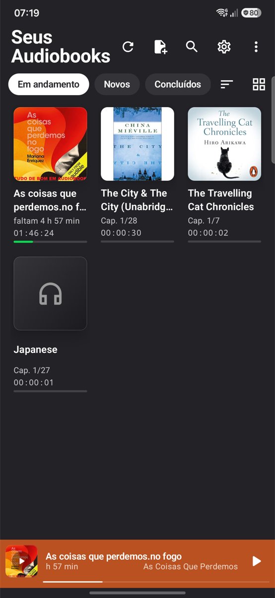
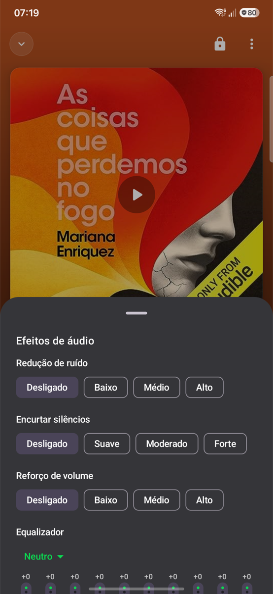

# Abbay Audiobook Player

Abbay is an Android audiobook player app built with Jetpack Compose and ExoPlayer. It supports single and multi-chapter books, playback speed control, screen lock and more.

## Features

- 📚 Browse and play audiobooks from folders or single files (MP3, M4A/M4B, Opus, FLAC, …)
- 🗂️ Library tabs (In progress, New, Finished — shown, hidden and ordered in Settings) with list, grid and compact layouts
- 📖 Chapters from CUE sheets, M4B/MP4, ID3 and Matroska/Ogg tags, or one per file; chapter list, swipe the cover to change chapter
- ⏩ Small and large skips (15 s / 30 s / 5 min by default); hold a skip button to repeat it; double-tap the cover to skip
- 🎚️ Speed 0.5–3.5× per book, with presets and a default for new books
- 🎛️ Audio effects: noise reduction, silence trimming, volume boost and an equalizer
- 🌙 Sleep timer, bookmarks with notes, repeat, and intro/outro skipping from the player
- 📺 Cast to Chromecast devices and home-screen widgets
- ✏️ Book details: edit title, author, narrator and description, choose a cover (folder image, embedded, gallery or web), sort files by track number
- 🌓 Themes: System, Light, Dark, Black, and wallpaper colors on Android 12+; the open player and the status bar take the cover's color
- 🔒 Lock the player screen to prevent accidental touches
- 🛡️ Crash reports and usage statistics can be turned off in Settings; no ads, no accounts

## Screenshots

| Library | Grid | Player | Audio effects |
|---|---|---|---|
|  |  |  |  |

## Getting Started

### Prerequisites

- Android Studio (latest recommended), JDK 21
- Android device or emulator (API 29+ / Android 10+)
- `app/google-services.json` (not committed; CI writes it from a secret). For local debug builds any syntactically valid file for the package `com.mobyle.abbay` works.

### Build & Run

```sh
./gradlew assembleDebug                                   # build
./gradlew test                                            # unit tests
./gradlew lint detekt ktlintCheck checkModuleBoundaries   # static analysis
./gradlew checkLicense                                    # dependency license check
```

### Performance and Baseline Profile

`:benchmark` holds the Macrobenchmarks (cold start, library scrolling) and the Baseline Profile generator; they run against the `release` build (debug-signed when the publishing keystore is absent) on a device or emulator with a library loaded:

```sh
./gradlew :benchmark:connectedBenchmarkAndroidTest -Pandroid.testInstrumentationRunnerArguments.class=com.mobyle.abbay.benchmark.StartupAndScrollBenchmark
./gradlew :benchmark:connectedBenchmarkAndroidTest -Pandroid.testInstrumentationRunnerArguments.class=com.mobyle.abbay.benchmark.BaselineProfileGenerator
```

The generator needs a rooted device (an emulator `google_apis` image after `adb root`) or Android 13+. Copy the profile it writes under `benchmark/build/outputs/connected_android_test_additional_output/` to `app/src/main/baseline-prof.txt` and commit it after UI changes to startup, the library or the player.

## Project Structure

| Module | Content |
|---|---|
| `app` | Presentation (Compose UI, ViewModels, the playback service, Cast, widgets), infrastructure (navigation, audio processing), `Application`, DI wiring |
| `domain` | Pure Kotlin: models, repository interfaces, use cases |
| `data` | Room database (schema v3 + migrations), DataStore settings, SAF library scanner, tags and covers, background scans (WorkManager), repository implementations |
| `benchmark` | Macrobenchmarks and the Baseline Profile generator (test module, against the release build) |

Inside `app/src/main/java/com/mobyle/abbay/`:

| Folder | Content |
|---|---|
| `presentation/playback/` | `PlaybackService` (Media3 `MediaLibraryService`: notification with skip buttons, position saving, auto-stop, error handling), the player commands, and `PlayerControllerImpl`, the implementation of the domain `PlayerController` |
| `presentation/cast/` | Cast: the files, or the audio with its effects as a live WAV stream |
| `presentation/widget/` | Glance home-screen widgets |
| `infra/dsp/` | Audio processing: silence trimming, equalizer, balance, loudness, pitch, resampler; RNNoise noise reduction through JNI (C sources in `app/src/main/cpp/`) |

- `app/src/main/java/com/mobyle/abbay/presentation/booklist/widgets/MiniPlayer.kt` – The player (mini player and expanded state); its parts are in `widgets/player/`
- `app/src/main/java/com/mobyle/abbay/presentation/bookdetails/` – Book details and metadata editing
- `app/src/release/` – Release-only manifest (profileable from the shell, for the benchmarks)
- `app/src/main/res/raw/motion_scene.json5` – MotionLayout scene for player transitions
- `docs/screenshots/` – Screenshots used in this README
- `config/` – detekt, ktlint, license-check and module-boundary configuration

## Customization

- **Playback Speed:** Tap the speed button under the player controls.
- **Chapters:** Tap the chapter name under the cover to open the chapter list in a bottom sheet.
- **Library tabs and layout:** Tap the layout button next to the tabs (list, grid, compact list); show, hide and reorder the tabs in Settings → Library tabs.
- **Screen Lock:** Tap the lock icon to lock; double-tap the locked player to unlock.
- **Book details:** Player overflow menu → Book details, or long-press a book → Edit details.
- **Theme, language and display:** Settings → Appearance (theme, cover on the lock screen, keep the screen on while charging, seek-bar times, language).
- **Licenses, source code and privacy:** Settings → About.

## Contributing

Pull requests are welcome! For major changes, please open an issue first to discuss what you would like to change.

## License

[MIT](LICENSE)

---

*Made with ❤️ for audiobooks!*
